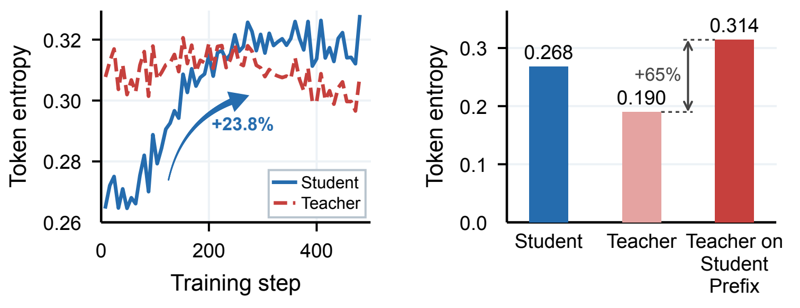
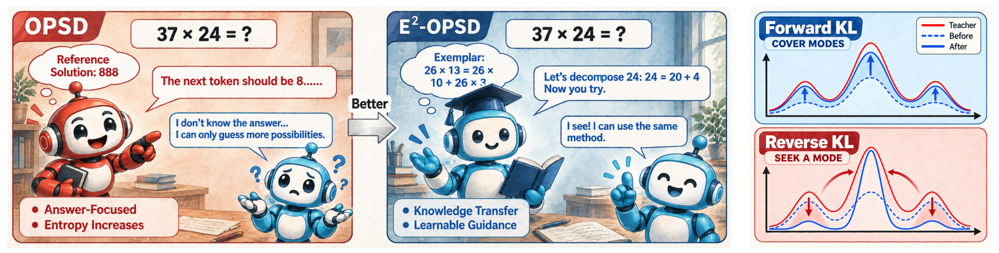
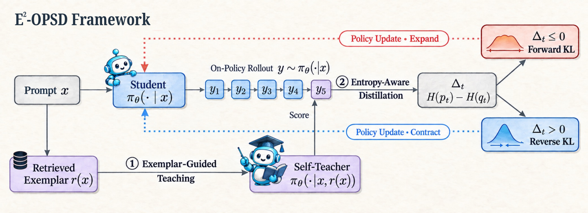
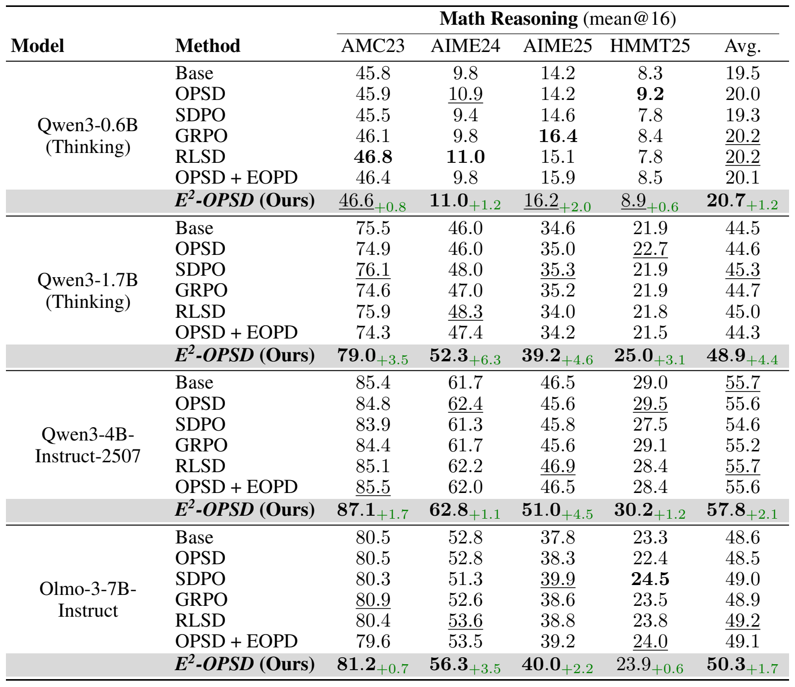

<div align="center">

# E²-OPSD: Taming Entropy Overshoot<br>in On-Policy Self-Distillation

**Transfer reasoning strategies. Regulate exploration.**

</div>

## Introduction

On-policy self-distillation (OPSD) provides dense token-level supervision without a second model: one network acts as teacher with the reference solution and as student with only the problem. Yet the student's token entropy can rise past the teacher's and remain elevated—a failure mode we call **entropy overshoot**, where useful exploration spills into persistent and excessive uncertainty.

<p align="center">
  
</p>

**Left:** Entropy overshoot in Qwen3-1.7B. **Right:** The reference-conditioned teacher is less certain on student prefixes, suggesting a reasoning-path mismatch.

**E²-OPSD** addresses both sides of this failure: **Exemplar-Guided Teaching** transfers reusable reasoning strategies, while **Entropy-Aware Distillation** regulates when the student should explore versus concentrate—with **no additional forward passes or networks** during distillation.

## Method

<p align="center">
  
</p>

- **Exemplar-Guided Teaching (EGT): what to learn.** Replace the current problem's reference solution in the teacher's context with a retrieved solved neighboring problem. The exemplar provides transferable reasoning guidance without revealing the current answer.
- **Entropy-Aware Distillation (EAD): how to learn.** Bidirectional Entropy Routing (BER) uses forward KL when the student is more concentrated than the teacher and reverse KL when it is more diffuse. Adaptive Gap Damping (AGD) uses the gap magnitude to downweight uncertain routing decisions and emphasize larger entropy mismatches.

<p align="center">
  
</p>

At inference, the student receives only the original question.

## Results

E²-OPSD achieves the highest average math mean@16 across all four model configurations, improving over OPSD by up to **4.3 points**.

<p align="center">
  
</p>

## Release

This release contains E²-OPSD and five baselines (OPSD, SDPO, GRPO, RLSD, OPSD + EOPD) on a shared veRL runtime, with configurations for Qwen3-1.7B Thinking.

### Install

Linux, Python 3.12, CUDA 12.8; **8 × NVIDIA H200 GPUs**.

```bash
pip install torch==2.8.0 'setuptools<81' wheel packaging ninja
pip install --no-build-isolation -r requirements.txt
```

### Data

```bash
python scripts/download_data.py
```

Downloads the training file and verifies the bundled evaluation set. Sources and licenses: [data/README.md](data/README.md).

### Training

```bash
bash scripts/release/build_qwen3_1_7b_neighbors.sh     # EGT neighbors (E²-OPSD only)
bash scripts/release/train_qwen3_1_7b_thinking.sh e2opsd
```

Replace `e2opsd` with `opsd`, `sdpo`, `grpo`, `rlsd` or `eopd` for a baseline.

### Evaluation

```bash
bash scripts/release/evaluate.sh /path/to/model outputs/eval/e2opsd
```

Accepts a Hugging Face model or an FSDP `actor/` checkpoint directory.

## Attribution

Built on [RLCSD](https://github.com/THU-BPM/RLCSD) and [veRL](https://github.com/volcengine/verl). `third_party/verl` is a modified copy of veRL (Apache 2.0); see [MODIFICATIONS.md](third_party/verl/MODIFICATIONS.md). Code is released under the [MIT License](LICENSE); dataset licenses are in [data/README.md](data/README.md).

## Citation

```bibtex
@misc{liu2026e2opsd,
  title  = {E$^2$-OPSD: Taming Entropy Overshoot in On-Policy Self-Distillation},
  author = {Liu, Yifei and Fang, Minghao and Gu, Xinyu and Yao, Chengkai and Liu, Mengdi and Ma, Tengfei and Zheng, Jiangbin and Yu, Chang and Gao, Zhangyang},
  year   = {2026}
}
```
